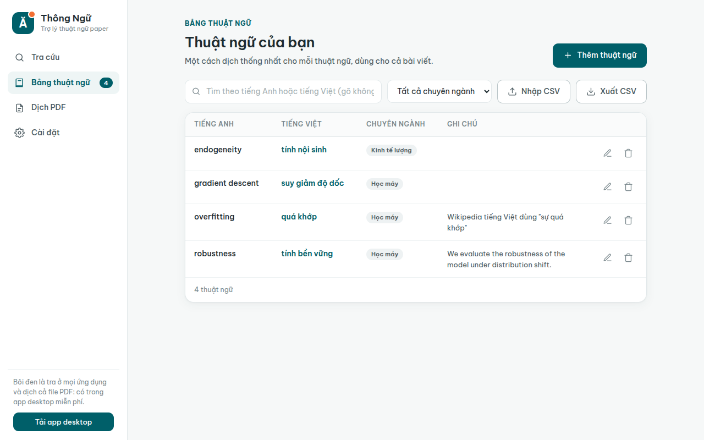

<p align="center">
  
</p>

<h1 align="center">Thông Ngữ</h1>

<p align="center">
  <b>Tra thuật ngữ Anh - Việt cho người đọc và viết paper.</b><br>
  Bôi đen một thuật ngữ, bấm phím tắt, xem ngay cách dịch mà cộng đồng đang dùng<br>
  rồi lưu cách dịch của bạn để cả bài viết dùng thống nhất.
</p>

<p align="center">
  <a href="https://thong-ngu.vercel.app"><b>Dùng ngay trên web</b></a> ·
  <a href="https://github.com/mhieuz-dev/thong-ngu/releases/latest"><b>Tải app desktop</b></a> ·
  Miễn phí, mã nguồn mở, không cần tài khoản
</p>


## Vì sao làm app này

Đọc paper tiếng Anh thì dễ, nhưng viết lại bằng tiếng Việt thì mỗi thuật ngữ là một lần phân vân: *overfitting* là "quá khớp" hay "trang bị quá mức"? *robustness* là "tính bền vững" hay "tính mạnh mẽ"? Google Dịch thường dịch từng chữ (ví dụ *overfitting* thành "trang bị quá mức"), còn cách gọi mà ngành đang dùng thì nằm rải rác trên Wikipedia, giáo trình, bài báo.

Thông Ngữ gom các nguồn đó vào một chỗ, xếp gợi ý nào được nhiều nguồn đồng ý lên trước, và giữ một **bảng thuật ngữ riêng** để lần sau bạn tra lại thì cách dịch mình đã chọn luôn hiện đầu tiên.

## Tính năng

| | Bản web | App desktop |
|---|:---:|:---:|
| Tra Anh → Việt và Việt → Anh (tự nhận chiều) | Có | Có |
| Gợi ý từ Wikipedia, Google Dịch, bộ nhớ dịch MyMemory, định nghĩa tiếng Anh | Có | Có |
| Gộp gợi ý trùng, ghi rõ nguồn nào cũng đồng ý | Có | Có |
| Bảng thuật ngữ riêng theo chuyên ngành, tìm không dấu, xuất/nhập CSV | Có (lưu trong trình duyệt) | Có (lưu trên máy) |
| Dán cả câu: dịch câu và chỉ ra thuật ngữ bạn đã lưu nằm trong câu | Có | Có |
| **Bôi đen ở bất kỳ ứng dụng nào rồi bấm `Ctrl` `Alt` `E`** | Không | Có |
| **Dịch cả file PDF, giữ nguyên bố cục, công thức, bảng, hình** | Không | Có |



## Cài app desktop

Vào trang [Releases](https://github.com/mhieuz-dev/thong-ngu/releases/latest) và tải bản cho máy bạn:

- **Windows**: file `.msi` hoặc `-setup.exe`. Bôi đen chữ, bấm `Ctrl+C` rồi bấm `Ctrl+Alt+E`.
- **macOS**: file `.dmg` (Apple Silicon `aarch64` hoặc Intel `x64`). Lần đầu mở: chuột phải vào app, chọn Open.
- **Linux**: file `.deb` (Ubuntu/Debian) hoặc `.AppImage`. Trên GNOME, vào **Cài đặt** trong app và bấm **Cài phím tắt**; sau đó chỉ cần bôi đen rồi bấm `Ctrl+Alt+E`, không cần copy.

App chưa có chữ ký số nên Windows SmartScreen hoặc macOS Gatekeeper có thể cảnh báo khi mở lần đầu: chọn **More info → Run anyway** (Windows) hoặc chuột phải → **Open** (macOS), miễn là bạn tải từ trang Releases của repo này.

Đóng cửa sổ thì app ẩn xuống khay hệ thống để phím tắt bật lên tức thì. Muốn thoát hẳn, bấm vào biểu tượng trên khay và chọn **Thoát**.

### Dịch cả file PDF

Tab **Dịch PDF** dùng [PDFMathTranslate](https://github.com/PDFMathTranslate/PDFMathTranslate) chạy ngay trên máy bạn. Cài một lần (cần Python 3.10 đến 3.13):

```bash
uv tool install pdf2zh-next      # hoặc: pipx install pdf2zh-next
```

Lần dịch đầu tiên sẽ tải khoảng 340 MB mô hình nhận dạng bố cục. Một trang paper mất khoảng 10 đến 20 giây. Nếu Google báo lỗi 429 (chặn tạm vì quá nhiều yêu cầu), hãy chọn Bing trong tab Dịch PDF.

## Dữ liệu và quyền riêng tư

- Chữ bạn tra được gửi thẳng từ máy bạn tới Wikipedia, Google Dịch, MyMemory và Free Dictionary API để lấy kết quả. Không có máy chủ trung gian của Thông Ngữ.
- Bảng thuật ngữ chỉ nằm trên máy bạn (app: SQLite trong thư mục dữ liệu ứng dụng; web: bộ nhớ của trình duyệt). Hãy **Xuất CSV** định kỳ để sao lưu.

## Tự build từ mã nguồn

Cần [Rust](https://rustup.rs), Node.js 18+ và (trên Linux) các thư viện của Tauri:

```bash
sudo apt install -y libwebkit2gtk-4.1-dev libxdo-dev libssl-dev libayatana-appindicator3-dev librsvg2-dev
npm install
npx tauri dev                    # chạy thử
npx tauri build --no-bundle      # build bản release
scripts/install-linux.sh         # Linux: cài vào ~/.local, thêm vào menu và cài phím tắt (không cần sudo)
```

Cấu trúc:

```
core/        Lõi Rust: bảng thuật ngữ (SQLite), các nguồn tra cứu, gộp gợi ý. Không phụ thuộc giao diện.
src-tauri/   App desktop (Tauri v2): cửa sổ, phím tắt, đọc chữ đang bôi đen, dịch PDF.
ui/          Giao diện HTML/CSS/JS thuần, dùng chung cho app và bản web.
ui/js/web-backend.js   Lõi cho bản web, chuyển thể từ core/ sang JavaScript.
```

Kiểm thử:

```bash
cargo test --workspace                                        # 64 test Rust
cargo test -p thongngu-core --test live -- --ignored          # gọi mạng thật
node --test web-tests/web-backend.test.js                     # 17 test bản web, cùng dữ liệu mẫu với Rust
```

Mở `ui/index.html?mock=1` bằng trình duyệt để xem giao diện với dữ liệu giả, không gọi mạng.

## Ghi công

- [PDFMathTranslate](https://github.com/PDFMathTranslate/PDFMathTranslate) và [BabelDOC](https://github.com/funstory-ai/BabelDOC) (AGPL-3.0): phần dịch PDF giữ bố cục. Thông Ngữ chỉ gọi chương trình này nếu bạn tự cài, không đóng gói kèm.
- Dữ liệu tra cứu: [Wikipedia](https://www.wikipedia.org) (CC BY-SA), [MyMemory](https://mymemory.translated.net), [Free Dictionary API](https://dictionaryapi.dev) (Wiktionary, CC BY-SA), Google Dịch.
- Font [Be Vietnam Pro](https://fonts.google.com/specimen/Be+Vietnam+Pro) (SIL OFL 1.1), icon theo phong cách [Lucide](https://lucide.dev) (ISC).
- Tông màu lấy cảm hứng từ Đại học Kinh tế TP.HCM (UEH). Đây là dự án cá nhân, không phải sản phẩm chính thức của trường.

## Giấy phép

[MIT](LICENSE)
