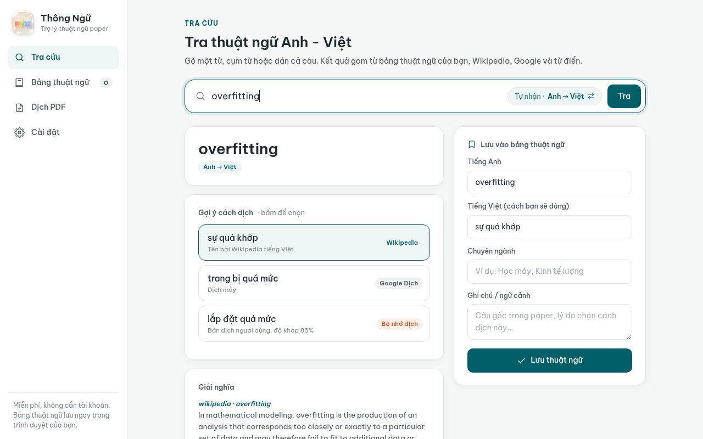
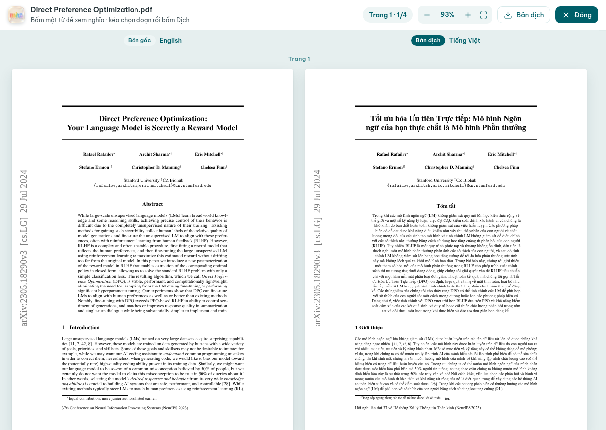

<p align="center">
  
</p>

<h1 align="center">Thông Ngữ</h1>

<p align="center">
  <b>Tra thuật ngữ Anh - Việt và dịch paper PDF cho người đọc, viết nghiên cứu.</b><br>
  Xem cách dịch mà cộng đồng đang dùng, lưu cách dịch của bạn để cả bài viết thống nhất,<br>
  dịch cả file PDF mà vẫn giữ nguyên bố cục, công thức, bảng và hình.
</p>

<p align="center">
  <a href="https://translate.mhieuz.com"><b>Dùng ngay: translate.mhieuz.com</b></a><br>
  Miễn phí, mã nguồn mở, không cần tài khoản, dùng được trên điện thoại
</p>



## Vì sao làm trang này

Đọc paper tiếng Anh thì dễ, nhưng viết lại bằng tiếng Việt thì mỗi thuật ngữ là một lần phân vân: *overfitting* là "quá khớp" hay "trang bị quá mức"? Google Dịch thường dịch từng chữ (ví dụ *overfitting* thành "trang bị quá mức"), còn cách gọi mà ngành đang dùng thì nằm rải rác trên Wikipedia, giáo trình, bài báo.

Thông Ngữ gom các nguồn đó vào một chỗ, xếp gợi ý được nhiều nguồn đồng ý lên trước, và giữ một **bảng thuật ngữ riêng** để lần sau tra lại thì cách dịch bạn đã chọn luôn hiện đầu tiên.

## Tính năng

- **Tra Anh → Việt và Việt → Anh**, tự nhận chiều theo chữ bạn gõ.
- Gợi ý từ **Wikipedia** (tên thuật ngữ cộng đồng dùng), **Google Dịch**, **bộ nhớ dịch MyMemory** (bản dịch của người thật) và **định nghĩa tiếng Anh**. Gợi ý trùng được gộp, ghi rõ nguồn nào cũng đồng ý.
- **Bảng thuật ngữ riêng** theo chuyên ngành, tìm không dấu, xuất/nhập CSV.
- **Dán cả câu**: dịch câu và chỉ ra những thuật ngữ bạn đã lưu nằm trong câu.
- **Dịch cả file PDF** bằng [PDFMathTranslate](https://github.com/PDFMathTranslate/PDFMathTranslate): giữ bố cục, công thức, bảng, hình; chọn được trang cần dịch.
- **Chữ bản dịch giống bản gốc**: tự nhận font của paper, bài dùng Times thì dịch bằng TeX Gyre Termes, bài dùng font LaTeX mặc định thì dịch bằng Latin Modern (cả hai đủ dấu tiếng Việt), cỡ chữ gần bằng bản gốc, kích thước trang giữ nguyên.
- **Đọc song song**: dịch xong tự mở trang gốc và trang dịch cạnh nhau, luôn khớp từng trang. **Bấm vào một từ** (hoặc kéo chọn cả cụm) để xem nghĩa tiếng Việt và lưu vào bảng thuật ngữ, câu chứa từ được ghi làm ngữ cảnh.



## Dữ liệu và quyền riêng tư

- Chữ bạn tra được gửi thẳng từ trình duyệt tới Wikipedia, Google Dịch, MyMemory và Free Dictionary API. Không đi qua máy chủ của Thông Ngữ.
- Bảng thuật ngữ chỉ nằm trong trình duyệt của bạn. Xoá dữ liệu trình duyệt sẽ mất bảng, hãy **Xuất CSV** định kỳ để sao lưu.
- File PDF được gửi lên máy chủ dịch của Thông Ngữ, dịch qua Bing Translator, rồi **tự xoá sau 2 giờ**. Mỗi lượt dịch có mã ngẫu nhiên, người khác không đoán được. Đừng tải lên tài liệu mật.
- Giới hạn để máy chủ miễn phí phục vụ được nhiều người: tối đa 30 MB, 40 trang mỗi lần, 2 file cùng lúc mỗi người, dịch lần lượt từng file.

## Cấu trúc

```
ui/                    Trang web tĩnh (HTML/CSS/JS thuần), deploy lên Vercel
ui/js/web-backend.js   Lõi tra cứu chạy trong trình duyệt: gọi nguồn, lọc nhiễu, gộp gợi ý, bảng thuật ngữ
ui/js/pdf.js           Trang Dịch PDF: tải file lên máy chủ, theo dõi tiến độ, xem/tải bản dịch
server/                Máy chủ dịch PDF (FastAPI + PDFMathTranslate-next), chạy trên VPS sau Caddy
web-tests/             Test lõi web bằng dữ liệu thật đã lưu từ các nguồn
```

## Chạy trên máy

```bash
# Trang web
cd ui && python3 -m http.server 8765        # mở http://127.0.0.1:8765

# Máy chủ dịch PDF (cần Python 3.10 đến 3.13, nên dùng uv)
cd server
uv venv .venv && uv pip install -r requirements-dev.txt
.venv/bin/uvicorn app:app --port 8787       # mở http://127.0.0.1:8765/?pdfapi=http://127.0.0.1:8787
```

Lần dịch đầu tiên tải khoảng 340 MB mô hình nhận dạng bố cục. Thêm `?mock=1` vào link để xem giao diện với dữ liệu giả.

Kiểm thử:

```bash
node --test web-tests/web-backend.test.js           # lõi web, 17 test
cd server && .venv/bin/pytest -q tests              # máy chủ PDF, dùng cầu nối giả
THONGNGU_LIVE=1 .venv/bin/pytest -q tests -k live   # dịch thật một trang (cần mạng)
```

## Triển khai

- **Web**: `npx vercel deploy --prod` từ thư mục gốc (`vercel.json` chỉ phục vụ thư mục `ui/`).
- **Máy chủ PDF**: `server/deploy/deploy.sh root@<ip-vps>` cài dịch vụ systemd `thongngu-pdf` (giới hạn 1 nhân CPU, RAM có trần, độ ưu tiên thấp để chạy chung VPS với dịch vụ khác), rồi dán `server/deploy/Caddyfile.snippet` vào Caddyfile.

## Ghi công

- [PDFMathTranslate](https://github.com/PDFMathTranslate/PDFMathTranslate) và [BabelDOC](https://github.com/funstory-ai/BabelDOC) (AGPL-3.0): phần dịch PDF giữ bố cục, chạy như một chương trình riêng trên máy chủ.
- Dữ liệu tra cứu: [Wikipedia](https://www.wikipedia.org) (CC BY-SA), [MyMemory](https://mymemory.translated.net), [Free Dictionary API](https://dictionaryapi.dev) (Wiktionary, CC BY-SA), Google Dịch, Bing Translator.
- Font [Be Vietnam Pro](https://fonts.google.com/specimen/Be+Vietnam+Pro) (SIL OFL 1.1), icon theo phong cách [Lucide](https://lucide.dev) (ISC).
- Tông màu lấy cảm hứng từ Đại học Kinh tế TP.HCM (UEH). Đây là dự án cá nhân, không phải sản phẩm chính thức của trường.

## Giấy phép

[MIT](LICENSE)
